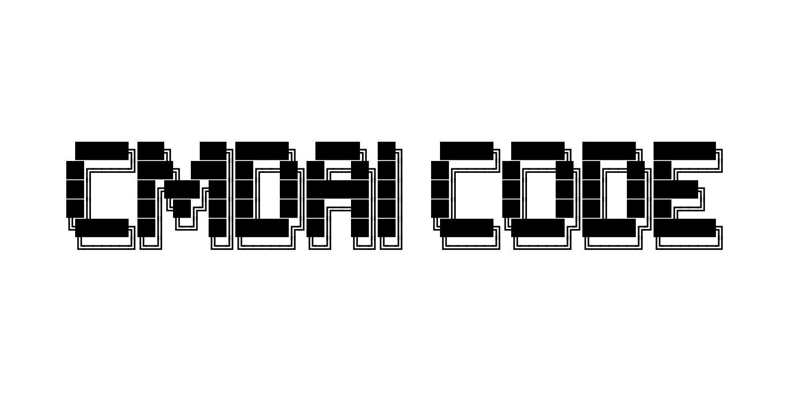

<div align="center">
  

  <p align="center">
    <a href="https://github.com/Krzyzyk33/CMDAI-CODE/releases"></a>
    <a href="#"></a>
    <a href="#"></a>
    <a href="#"></a>
    <a href="LICENSE"></a>
  </p>

### Autonomous Terminal Coding Agent
*Powered by local GGUF models (llama.cpp) and multi-provider cloud AI.*

</div>


## 🌟 About

**CMDAI CODE** is an autonomous terminal coding agent running directly inside your Windows console (Windows Terminal & PowerShell). Built from the ground up for privacy, speed, and developer autonomy:
- **Local-First**: Native support for quantized `.gguf` models via `llama.cpp` with Vulkan / CPU acceleration — write code completely offline without sending data to external servers.
- **Multi-Provider Cloud**: Seamless integration with top AI providers (OpenCode Zen, OpenRouter, Anthropic Claude, OpenAI, Google Gemini, Ollama, vLLM, and any custom OpenAI-compatible endpoints).
- **Autonomous Subagents & Background Workers**: Delegate heavy tasks to specialized subagents (Code Reviewer, Tester, Refactor) running synchronously or in the background (`Ctrl+B` / `/bg`).
- **Modern Terminal UI (TUI)**: Minimalist, clean GitHub Dark styled interface built on Textual — featuring real-time colored diffs, a session manager, and native Model Context Protocol (MCP) support.

---

## 🚀 Key Features

- ⚡ **Local GGUF (Vulkan / CPU)**: Automatic discovery and loading of `.gguf` weights from the `models/` directory. Fast token generation without complex setup.
- 🌐 **Custom AI Providers**: Built-in provider manager in `/models` (`Ctrl+A`) — easily connect any OpenAI-compatible API (Groq, Together AI, DeepInfra, self-hosted vLLM).
- 🗂️ **Advanced Session Manager (`/sessions`)**: Persistent conversation history, automatic AI session titles, live filtering, and instant context switching.
- ⚙️ **Background Jobs (`/bg`)**: Inspect running background tasks, track progress, and read logs in real time without blocking the terminal.
- 🔍 **Interactive Diff Viewer (`/diff`)**: Clear syntax-highlighted diffs of file modifications with one-click accept/reject controls.
- 🔌 **Model Context Protocol (MCP)**: Extensibility with external tools and MCP servers.

---

## 📥 Installation

Choose your preferred installation method:

### 1. PowerShell One-Liner (Recommended for Windows)
No Git or Node.js required. Automatically downloads, configures, and launches the application:
```powershell
irm https://raw.githubusercontent.com/Krzyzyk33/CMDAI-CODE/main/install.ps1 | iex
```

### 2. NPX / NPM (Node.js Developers)
Run instantly without prior setup:
```bash
npx github:Krzyzyk33/CMDAI-CODE
```
Or install globally via npm:
```bash
npm install -g github:Krzyzyk33/CMDAI-CODE
```

### 3. PIP / PIPX (Python Developers)
Install directly from GitHub:
```bash
pip install git+https://github.com/Krzyzyk33/CMDAI-CODE.git
```
Or run in an isolated environment with `pipx`:
```bash
pipx run --spec git+https://github.com/Krzyzyk33/CMDAI-CODE.git cmdai code
```

### 4. Git Clone (Manual Setup)
```powershell
git clone https://github.com/Krzyzyk33/CMDAI-CODE.git
cd CMDAI-CODE
.\install.bat
```

---

## 💻 CLI Commands

Once installed, use the global `cmdai` command from any directory:

| Command | Description |
| :--- | :--- |
| `cmdai code [dir]` | Launch the CMDAI CODE terminal coding agent in the specified workspace |
| `cmdai editor [file]` | Open the built-in terminal file editor |
| `cmdai mcp [command]` | Manage Model Context Protocol servers (`list`, `add`, `remove`, `test`) |
| `cmdai update` | Check for and install the latest updates directly from GitHub |
| `cmdai addlocal` | Interactive wizard to download or configure local `.gguf` models |
| `cmdai --install-launcher` | Register the global Windows terminal shortcut |

---

## ⌨️ Keybindings & Slash Commands

### Main In-App Slash Commands:
| Command | Description |
| :--- | :--- |
| `/models` | Select active local GGUF model or cloud provider |
| `/sessions` | Browse and manage saved conversation sessions |
| `/bg` | Monitor background processes and subagents |
| `/mode` | Switch agent mode (`auto`, `code`, `plan`) |
| `/diff` | Review proposed file changes with accept/reject |
| `/plan` | View and edit interactive execution plans |
| `/context` | Inspect and pin workspace files to agent context |
| `/help` | Complete cheat sheet and command reference |

### Keyboard Shortcuts:
- **`Enter`**: Submit prompt / select menu option
- **`Shift+Enter`**: Insert new line in prompt input
- **`Esc`**: Close active modal / cancel generation
- **`Ctrl+A`**: In `/models` – add new custom AI provider; in model list – add model
- **`Ctrl+D`**: Configure API key for selected provider
- **`Ctrl+B`**: Send current subagent task to background

---

## 🛠️ Project Structure

```text
CMDAI-CODE/
├── cmdai.py                  # Main CLI entry point
├── cmdai.bat                 # Windows batch launcher
├── install.ps1               # Automated PowerShell installer with CC progress bar
├── install.bat               # Local installation batch wrapper
├── package.json              # NPM package definition (supports npx github:...)
├── bin/                      # Launcher wrappers (Node.js & Windows)
├── assets/                   # Banners and visual assets
├── src/cmdai/
│   ├── agent/                # Agent loop, tool executors, subagents & background tasks
│   ├── core/                 # Session management, config, models & provider catalog
│   ├── editor/               # In-app file editor and diff engine
│   ├── mcp/                  # Native Model Context Protocol (MCP) client
│   └── tui/                  # Console UI (Textual): screens, modals, dark theme
└── models/                   # Folder for local .gguf model weights (optional)
```

---

## 📄 License

This software is provided under a custom personal and non-commercial license. See the [LICENSE](LICENSE) file for complete terms and restrictions.  
Copyright (c) 2026 Krzyzyk33. All Rights Reserved.
