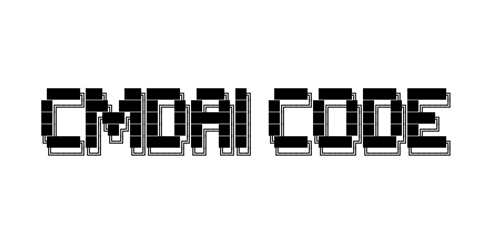

# Plan Aktualizacji i Ulepszenia Prezentacji Repozytorium GitHub (`CMDAI-CODE`)

Dokument zawiera kompletny, przygotowany plan modernizacji wizualnej oraz strukturalnej strony projektu na platformie GitHub (bez wprowadzania commitów w kodzie).

---

## 1. Baner Projektu (Proporcja 16:8 / 16:9)

Został wygenerowany programowo za pomocą skryptu Pillow i zapisany w:
`assets/banner.png` (rozdzielczość: 1600 × 800 px, format 16:8).

### Kompozycja wizualna banera:
- **Tło**: Ciemny motyw terminala (`#0d1117`), delikatna siatka techniczna (subtle grid) oraz radialna poświata w kolorze electric cyan / blue (`#18448c` / `#388bfd`).
- **Logotyp centralny**: Wierny, wycentrowany napis ASCII art `CMDAI CODE` z trójwarstwowym cieniem i podświetleniem neonowym.
- **Podtytuł**:
  - `Autonomous Terminal Coding Agent for Windows`
  - `Local GGUF (llama.cpp) · Multi-Provider Cloud AI · Autonomous Subagents & Background Tasks`
- **Pigułka informacyjna (Pill Badge)**:
  - `v3.0.6-alpha | Windows Terminal & PowerShell | Python 3.10+ | Model Context Protocol (MCP)`

---

## 2. Nowa Struktura `README.md`

Docelowy projekt profesjonalnego pliku `README.md` dla repozytorium:

### A. Nagłówek i Tarcze (Badges)
```markdown
<div align="center">
  

  <p align="center">
    <a href="https://github.com/Krzyzyk33/CMDAI-CODE/releases"></a>
    <a href="#"></a>
    <a href="#"></a>
    <a href="#"></a>
    <a href="#"></a>
  </p>
</div>
```

### B. Kluczowe Filary Architektury (Features)
- ⚡ **Local-First AI (GGUF / llama.cpp)**: Bezpośrednie uruchamianie lokalnych modeli kwantyzowanych `.gguf` (Qwen, DeepSeek, Llama, Mistral) bez konieczności stawiania zewnętrznych kontenerów czy serwerów.
- 🌐 **Multi-Provider Cloud**: Pełna integracja z dostawcami: OpenAI (GPT-4o), Anthropic (Claude 3.7 Sonnet), Google Gemini 2.5, OpenCode Zen, Ollama, vLLM.
- 🤖 **Autonomiczne Subagenty**: Równoległe delegowanie zadań do wyspecjalizowanych subagentów (Code Reviewer, Refactor, Tester) z podglądem na żywo oraz możliwością wysłania do tła (`Ctrl+B`).
- 🖥️ **Nowoczesne TUI (Textual)**: Estetyczny, ciemny motyw konsolowy z pełnym renderowaniem Markdown, kolorowymi diffami zmian w plikach i menedżerem sesji.
- 🔌 **Natywny Klient MCP (Model Context Protocol)**: Wsparcie dla zewnętrznych serwerów narzędziowych.

### C. Szybki Start (Quickstart)
Instrukcja uruchomienia w 3 krokach:
```powershell
# 1. Klonowanie repozytorium
git clone https://github.com/Krzyzyk33/CMDAI-CODE.git
cd CMDAI-CODE

# 2. Uruchomienie instalatora
cmdai.bat
```

### D. Tabela Skrótów Klawiszowych i Poleceń
| Polecenie / Skrót | Funkcja |
| :--- | :--- |
| `/models` | Wybór aktywnego modelu lokalnego lub dostawcy chmurowego |
| `/sessions` | Przeglądarka i menedżer zapisanych sesji z wyszukiwaniem |
| `/bg` | Monitor zadań terminala i subagentów pracujących w tle |
| `/mode` | Przełączanie trybu agenta: `auto`, `code`, `plan`, `ask` |
| `/diff` | Podgląd zmian i różnic w plikach roboczych |
| `/mcp` | Konfiguracja i status serwerów Model Context Protocol |
| `Ctrl+B` | Natychmiastowe przeniesienie aktywnego zadania/subagenta do tła |

---

## 3. Usprawnienia Prezentacji Repozytorium na GitHubie

1. **GitHub Topics (Tagi SEO)**:
   - `terminal-ai`, `agentic-ai`, `gguf`, `llama-cpp`, `coding-agent`, `python-tui`, `textual`, `windows-terminal`, `developer-tools`.
2. **Social Preview Image**:
   - Ustawienie pliku `assets/banner.png` jako domyślnego obrazka Open Graph w ustawieniach repozytorium (Settings -> General -> Social preview).
3. **Release Notes `v3.0.6-alpha`**:
   - Wzbogacenie opisu wydania o zrzuty ekranu oraz listę nowości (Swift-style reasoning blocks, OpenCode session titling, subagents multitasking).
